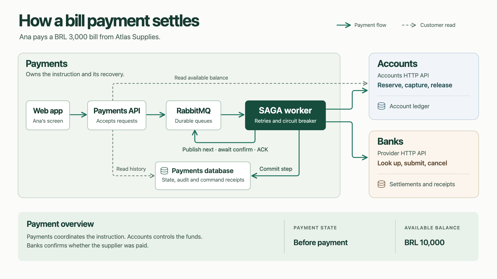

# Horizonte corporate payments

A finance operator at Horizonte pays a BRL 3,000 supplier bill. Accounts owns the money. Banks, an external provider simulator, owns settlement and the receipt. Payments owns the customer's instruction and has to recover when the provider commits a transfer and the response never arrives. This is a Jeeves-style corporate payments engineering challenge. The providers, funds and customer information are synthetic.

Start with the [one-page submission brief](demo/docs/submission-brief.pdf). The [illustrated engineering guide](demo/docs/evaluator-guide.pdf) walks through Ana’s payment, the service boundaries, the failure cases and the evidence behind each outcome. The [Markdown edition](demo/docs/evaluator-guide.md) includes editable diagrams.

## Projects

| Project | What its team owns | Entry points |
|---|---|---|
| [Payments](payments/README.md) | The web experience, public API, workflow, audit, RabbitMQ and Payments database | [API routes](payments/backend/src/server/routes/payments.ts), [worker](payments/worker/src/index.ts), [state transitions](payments/worker/src/services/advancePayment.ts) |
| [Accounts](accounts/README.md) | Available balance, reservations, captures, releases and an account ledger | [Routes](accounts/backend/src/server/routes/index.ts), [account repository](accounts/backend/src/db/repositories/accounts.ts) |
| [Banks](banks/README.md) | An external provider's payment status, cancellation decisions, settlement records and receipts | [Routes](banks/backend/src/server/routes/index.ts), [settlement rules](banks/backend/src/services/settlement.ts) |

This repository contains the complete evaluation checkout. Payments, Accounts and Banks are independent projects, each with its own release definition. The original development workspace keeps a separate Git repository for each service. There is no top-level application package or shared domain library. Each project directory can be copied, installed, built, tested and deployed on its own. Each owns its Compose definition, Docker build context, package manifest, dependency lock and database migrations or bootstrap. In Payments, the API, worker and web frontend have separate images and replica counts. The top-level Compose file brings these releases together for a local demonstration. The demo tools have their own development dependencies.

## Run the demo

Install Docker with Compose v2.24 or newer. Node 24+ runs the operator CLI. pnpm 10 runs the development and test scripts. Run the following commands from this directory.

```sh
source demo/env.sh
docker compose build
docker compose up -d --no-build --wait
docker compose ps
```

Open [Payments](http://localhost:5173). The synthetic account opens directly with BRL 10,000 on a fresh volume. Select **Pay a bill**, choose **Atlas Supplies** and confirm. A completed payment has a bank receipt and leaves BRL 7,000 available. The application and operator tools are for local demonstration. All published ports bind to loopback.

Open [Grafana](http://localhost:3000) to search for the payment in Tempo and follow its logs in Loki. To pause the lab while retaining data, run `docker compose stop`. To start again, run `docker compose up -d --no-build --wait`.

## Follow a payment



[Open the fullscreen diagram and step through the use cases](demo/docs/payment-architecture.html)

When the bank result is uncertain, the worker queries Banks using the original payment ID. A confirmed settlement leads to capture in Accounts. A definitive cancellation leads to release. If the worker can prove that submission never started, it can release the funds during a provider outage. All coordination is implemented in Payments. Its processes receive HTTP addresses for their providers. Each PostgreSQL server sits on its owner's private network. [Workflow and recovery](payments/docs/workflow.md) · [Database isolation probes](demo/evidence/boundaries/checks.json)

## Present and verify the project

- [Presentation guide](demo/docs/walkthrough.md) follows the payment and its failure cases on the diagram. It also includes the live-demo commands as a reference.
- [Architecture slides](demo/docs/payment-saga-walkthrough.pptx), [narrated Saga walkthrough in Portuguese](demo/docs/payment-saga-walkthrough-pt-BR.mp4) and [successful payment walkthrough in Portuguese](demo/docs/successful-payment-pt-BR.mp4) are available to download.
- [Independent release proof](demo/evidence/boundaries/independent-release.json) records a Payments worker rollout across three separately named Compose projects and a subsequent paid bill with the same Accounts and Banks containers.
- [Test and recording guide](demo/docs/testing.md) covers each project, the isolated E2E lab and telemetry verification.
- [Recorded evidence](demo/evidence/README.md) includes browser explorations, fault injection, Grafana recordings and the corresponding payment IDs.
