# Paying a supplier across three systems

**Horizonte Payments · Engineering challenge for Jeeves**

## The problem I chose

I have worked on this kind of bill-payment platform before. My team owned the instruction to pay, while an internal account service owned the customer's funds and an external bank owned settlement. We could read internal service code to understand a contract. We could only observe the bank through its published interface. The work had to ship entirely within Payments.

In this assessment, Ana pays a BRL 3,000 Atlas Supplies bill from a corporate account with BRL 10,000 available. She needs one balance, a payment history and a receipt. The difficult moment comes when the bank receives the instruction and the response disappears. Paying again could duplicate the transfer. Releasing the money could let Ana spend funds already paid to the supplier.

## Why I chose an orchestrated Saga

I have used the Saga pattern to solve this problem before. Each owner commits its own change. The Payments worker remembers what has happened and decides which public operation can safely follow. It reserves funds, asks the bank to settle, then captures the reservation. When the bank definitively rejects or cancels an instruction, the worker compensates by releasing the hold. A confirmed bank payment requires capture, even if a cancellation request is already in flight.

## The trade-off and the evidence

The API can acknowledge a queued instruction while the bank is slow. In return, the product needs pending states, command replay and an audit trail. During an ambiguous outage, a customer's money can stay reserved for hours. That is a deliberate financial decision.

In a recorded run, Banks settled the BRL 3,000 bill and dropped its response. Payments queried the original reference and recovered the receipt. The bank recorded one settlement and Accounts recorded one capture. The final available balance was BRL 7,000.

## How I used AI and what I would do next

I used Codex to implement and exercise the design, inspect traces and prepare the diagrams. I chose the ownership boundaries, separate API and worker deployments, and confirmation-before-ACK protocol. Before connecting a real bank, I would validate its reference, lookup and cancellation guarantees in its sandbox, and agree with operations on how to resolve and communicate long-running holds.

<!-- page -->

## Product and interfaces

Ana works in a finance team. From **Pay a bill**, she chooses a supplier invoice, checks the amount and confirms once. The web app shows a single available balance, the payment's status, its history and the receipt when available. For a pending payment, Ana can request cancellation. The UI explains that a bill already paid by the bank will complete. Operators change simulator conditions through the CLI.

| Customer action | Payments API contract |
|---|---|
| Open the account | `GET /api/account` reads available funds from Accounts. `GET /api/bills` returns the bill catalogue. |
| Confirm a bill | `POST /api/payments` accepts a `billRef` and an `Idempotency-Key`. The server derives the amount, currency and beneficiary. |
| Follow a payment | `GET /api/payments` lists recent instructions. `GET /api/payments/:id` returns state, ordered events and the bank reference when known. |
| Request cancellation | `POST /api/payments/:id/cancel` queues the request. A `202` acknowledges the command. The history shows the eventual financial outcome. |

**The provider contracts.** Accounts offers an available-balance read and idempotent `reserve`, `capture` and `release` operations. Banks offers `submit`, a status lookup by the original payment ID and `cancel`. That same reference must identify the same instruction on every retry. A successful bank reply includes a receipt.

**What Ana sees.** The detail view progresses from *Request received* through *Awaiting bank confirmation* to *Paid*. The separate *Completing payment* state means the bank has confirmed settlement and Accounts still needs to capture the hold. Ana can open *View receipt* once the payment is paid.

**What is simulated.** The repository includes runnable provider stand-ins so a reviewer can reproduce failures. On the Payments side, the internal account service is a separately owned dependency and the external bank is a black box. Its simulator's source, database and test controls are conveniences for the lab. Payments only calls the provider contracts at runtime.

**Reading the diagrams.** Each failure example starts from the same fresh BRL 10,000 account unless stated otherwise. Arrows identify the caller and recipient. A broken return arrow marks a missing response. The diagrams use P for the payment ID and K for the browser's idempotency key.

<!-- page -->

## Architecture and ownership

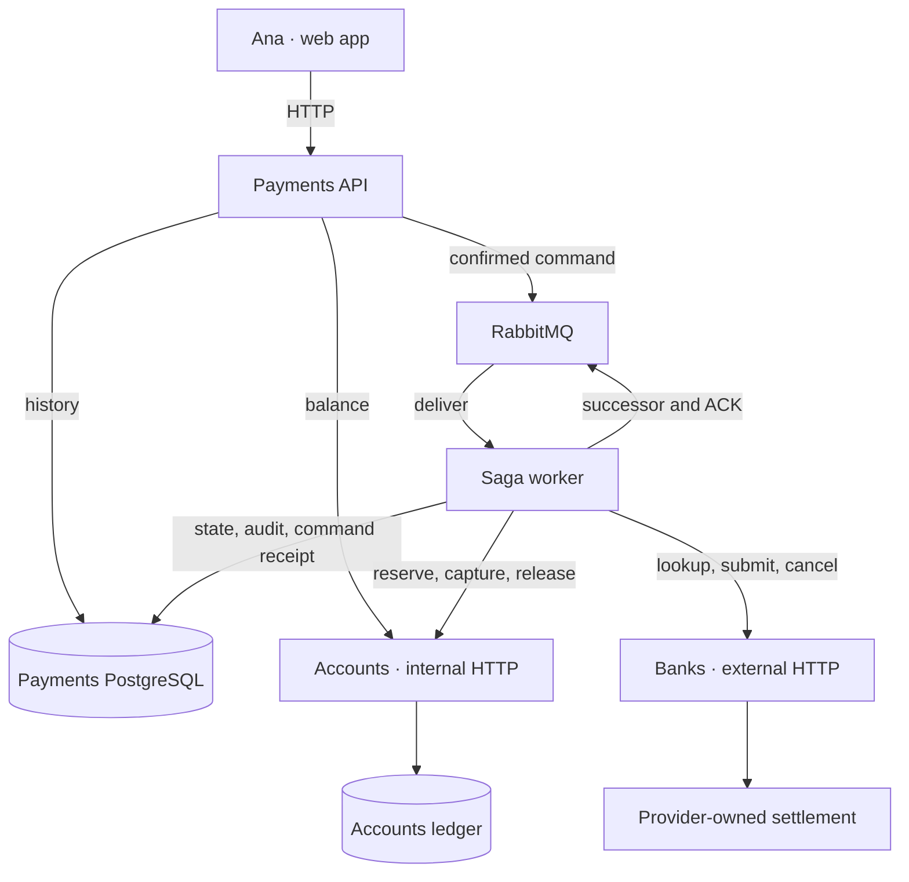

The web app, Fastify API and Saga worker are separate deployments within Payments. The API serves reads and admits commands. It uses the `payments.intake` exchange to reach the create or cancel queue. Worker replicas handle RabbitMQ deliveries and provider latency. They scale independently. Accounts owns the ledger. Banks owns the answer to whether money reached the supplier. Each simulator has its own PostgreSQL instance on its owner's private network.

| RabbitMQ queue | When it is used |
|---|---|
| `payments.create` | The API admits a bill. A worker creates the payment row. |
| `payments.process` | A worker publishes the next immediately runnable Saga step. |
| `payments.retry` | A worker schedules a retry, status check or attempt to probe the bank. RabbitMQ delays delivery until due. |
| `payments.cancel` | The API publishes Ana's request or a worker publishes an automatic cancellation. |
| `payments.dlq` | Invalid-command reports and work requiring operator review are parked here. |

All five are durable quorum queues. The worker consumes the first four. The local broker uses one node and a persistent volume. Broker restart recovery in this setup assumes that volume survives. OpenTelemetry carries telemetry across HTTP and RabbitMQ to a local Grafana stack. The audit and financial state live in their owners' databases.

<!-- page -->

## What the Saga can compensate

A worker running three calls in order would still face three independent commits. After a timeout it needs to know which operation might have taken effect and which identifier makes another attempt safe. Here that policy lives in the worker's versioned state machine. Each new delivery resumes a decision the system can explain.

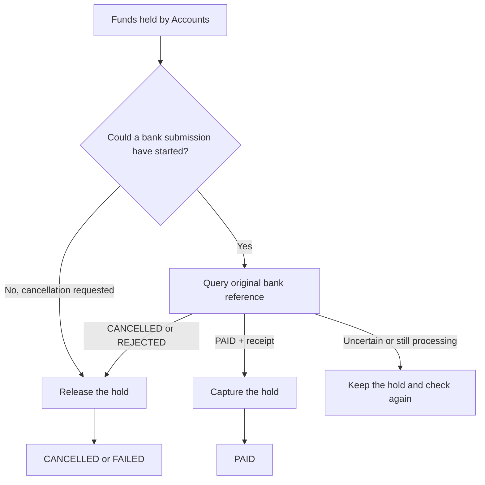

| Durable milestone | Who committed what? | Available balance |
|---|---|---|
| `RESERVATION_PENDING` | Payments created the instruction. At initial creation Accounts has yet to confirm a hold. | BRL 10,000 initially |
| `AWAITING_SUBMISSION` | Accounts confirmed the BRL 3,000 reservation. | BRL 7,000 |
| `AWAITING_CONFIRMATION` | Payments has a durable intent to submit. The bank outcome can still be unknown. | BRL 7,000 |
| `DEBIT_PENDING` → `PAID` | Banks confirmed settlement. Accounts captures the existing hold. | BRL 7,000 |
| `CANCELLATION_PENDING` → `CANCEL_RELEASE_PENDING` → `CANCELLED` | Cancellation is requested, release becomes safe, then Accounts confirms release. | BRL 10,000 after release |
| `FAILURE_RELEASE_PENDING` → `FAILED` | A bank rejection requires release. Insufficient funds can go directly from reservation pending to failed. | Restored on release, unchanged on insufficient funds |

Compensation is a new business operation with its own success or failure. A refund of a settled bank transfer would be a different product workflow. The available balance can change at Accounts before Payments receives or records the corresponding confirmation.

<!-- page -->

## Successful payment · acceptance and reservation

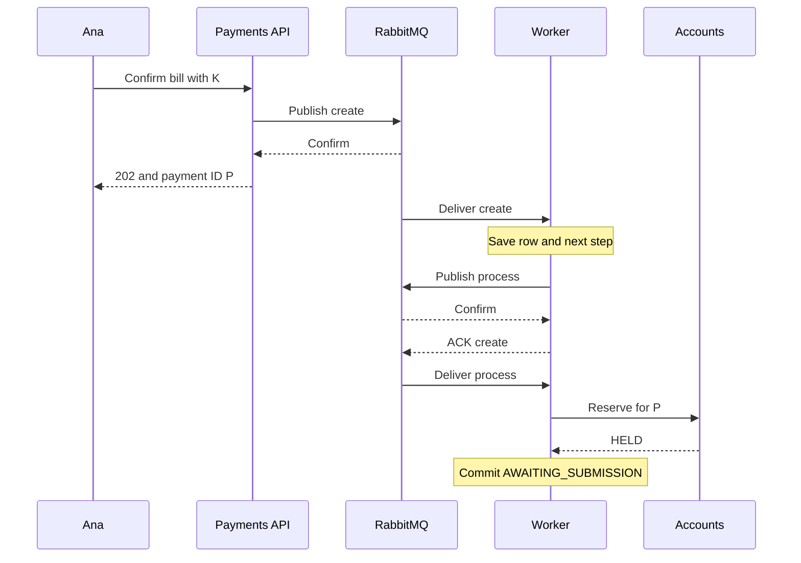

1. The browser keeps key **K** in session storage for this bill until the API acknowledges it. The API derives payment ID **P** from the company and key. A repeat of the same request reaches the same instruction.
2. The API checks the bill and any stored financial terms, then publishes with mandatory routing on a confirm channel. Only a confirmed, routed publication returns `202` and the payment location. A worker can create the row later, so an immediate detail read may briefly return `404`.
3. The worker inserts `RESERVATION_PENDING`, appends the creation event and records the next command in one Payments transaction. It commits, publishes the successor, waits for the broker confirm and ACKs the original delivery.
4. On the next delivery, Accounts commits the hold for **P**. Ana's available balance moves from BRL 10,000 to BRL 7,000. Atlas is still awaiting payment. The worker records `FUNDS_RESERVED` and hands off the next step using the same protocol.

<!-- page -->

## Successful payment · settlement and capture

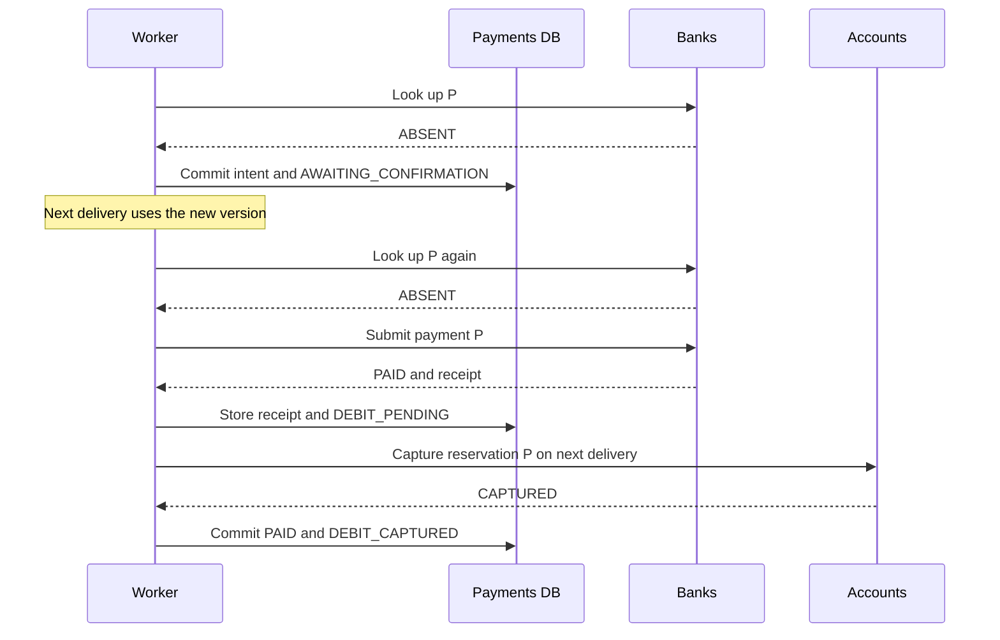

5. The first lookup finds no transfer. The worker persists permission to submit **before** a bank request can move money. The following delivery rechecks **P**. If it is still absent, that delivery submits the original reference.
6. Banks settles the supplier bill and returns its receipt. Payments stores that evidence and advances to `DEBIT_PENDING`. The supplier has been paid and the account still has a hold.
7. Accounts converts the existing hold into one final debit. The available balance stays at BRL 7,000. Payments commits `PAID` and the worker ACKs the final delivery. Ana can reopen the payment and see the receipt.

**What to observe.** A publisher confirm means a message reached RabbitMQ. A consumer ACK means the worker finished handling a delivery. A bank receipt means the supplier was paid. These signals come from different owners. Only the last one authorizes capture of an externally settled payment.

<!-- page -->

## The Payments API is unavailable

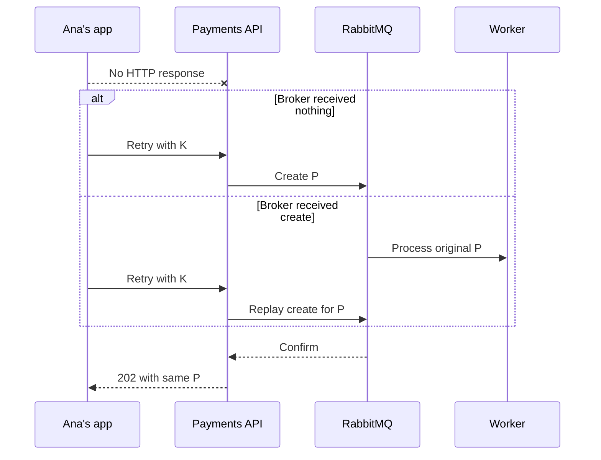

**Customer experience.** A connection failure or proxy error leaves the request unconfirmed. If the UI is already open, the browser retains the key and offers another attempt. When all API replicas are unavailable, balance, history and cancellation requests through that API are also unavailable. Ana can retry from the same browser session after recovery.

**Recovery.** If no create command reached RabbitMQ, the retry starts work. If the API published and then died, or the reply was lost on its way back, the original worker can already be processing the bill. Both sends use the same payment and create-command IDs. The worker uses its recorded decision on replay. Repeated financial calls use the same payment ID at the provider.

**Money and proof.** An HTTP error alone says nothing about whether funds moved. Query **P** once the API recovers. The browser exploration discards a real acceptance response, retries the same intent and checks one settlement and one capture. That recording exercises the lost-response window. The all-replicas-down branch follows from the API and worker being separately deployed.

**Try it locally.** Stop the API with `docker compose stop payments-api`. Attempt a payment from an open tab. Run `docker compose start payments-api` and retry the same bill in that tab.

[Browser replay evidence](../evidence/explorations/04-client-response-lost.json) · [API admission tests](../../payments/backend/tests/payments.test.ts)

<!-- page -->

## RabbitMQ is unavailable or loses a confirm

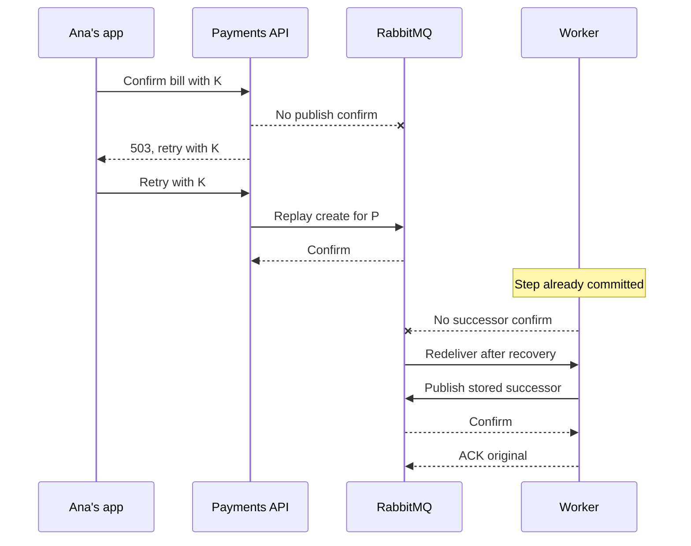

**At intake.** The same rule applies to a cancellation: if its publication is unconfirmed, the API returns `503` and the client can retry the same cancellation for P. Publication can fail immediately or time out waiting for a confirm. A live but stalled broker has a five-second confirmation deadline in this implementation. The API returns `503` if it can respond. A timed-out publisher cannot infer whether the broker stored the message. The customer retries with the same key. Payment history remains readable when its read dependencies are healthy.

**Mid-workflow.** The design has no outbox publisher. A worker that cannot confirm its next publication leaves the original unacknowledged. The channel closes on handler error. Once the broker and consumer reconnect, the original delivery drives recovery from the stored command receipt. If the successor actually arrived, its stable ID and version make the duplicate safe.

**What survives.** A confirmed persistent command in a durable quorum queue survives the demonstrated broker restart with intact storage. A single-node lab has no second broker to serve through node loss. Recorded checks cover missing publisher confirmation and a broker restart with previously accepted work.

**Try it locally.** Run `docker compose stop rabbitmq`, attempt a new payment, then run `docker compose start rabbitmq`. Once RabbitMQ is ready, retry with the same key.

[Broker pause and restart results](../evidence/resilience/checks.json) · [Delayed-delivery test](../../payments/worker/tests/integration/delayedDelivery.test.ts)

<!-- page -->

## A worker stops between two commits

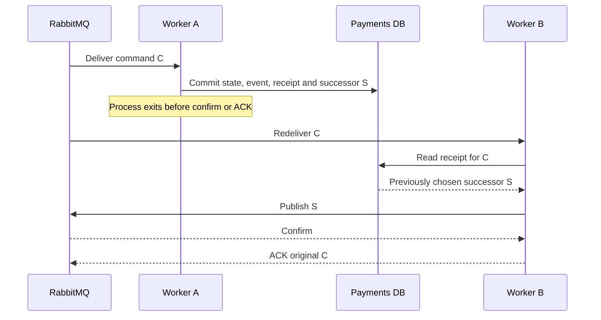

| Failure window | What the next worker does |
|---|---|
| All workers are stopped | Messages stay queued. A healthy API can still return `202`. The Saga resumes when a consumer is available. |
| Provider committed, local decision did not | Retry the same Accounts operation or query Banks by **P**. The provider may already have performed the effect. |
| Local commit succeeded, successor was never published | Read the stored command receipt and publish the saved successor. The diagram shows this case. |
| Successor reached the queue, original ACK was lost | Republish the same successor if necessary. A duplicate receipt or stale version prevents the workflow from advancing twice. |

A PostgreSQL advisory lock serializes decisions for a company and payment. A version check guards updates and process commands carry the expected version. Different payments can advance on different replicas. Calls to providers can outlive a local rollback, so this still requires provider idempotency.

**Recorded outcome.** The test killed the worker after a local commit and, in a separate run, after a provider effect. Both payments reached `PAID` with one bank settlement and one account capture.

**Try it locally.** Before submitting a new bill, run `node demo/scripts/operator.ts worker failpoint after-commit`. Follow its payment ID through worker redelivery.

[Fault-injection results](../evidence/resilience/checks.json) · [Command recovery tests](../../payments/worker/tests/integration/paymentRecovery.test.ts)

<!-- page -->

## Accounts is unavailable

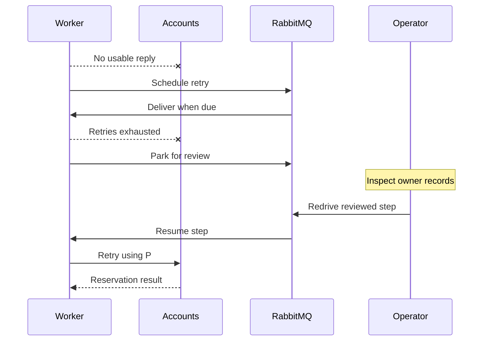

**Before submission.** If reserve fails or its reply is lost, Payments stays in `RESERVATION_PENDING`. The request may already have created a hold. The worker repeats reserve for **P**. A confirmed hold permits bank submission. A definitive insufficient-funds result ends the payment as `FAILED`.

**After settlement or cancellation.** If Banks has paid, the worker stays in `DEBIT_PENDING` and retries capture. If a release is due, it stays in the corresponding release-pending state and retries release. The worker preserves the receipt and the reason for the pending entry. The account endpoint returns `503` if it cannot retrieve a current balance.

**After the retry budget.** Payments sets `review_required` and parks the command. The operator inspects the owner records and redrives the eligible stored successor with its original ID and version. A redrive republishes to `payments.process`. The parked DLQ message can remain for review. Invalid-command reports have a separate purpose and cannot be redriven as a payment decision.

**Try it locally.** Stop and restore Accounts with `docker compose stop accounts-service` and `docker compose start accounts-service`. For an eligible reviewed payment, run `node demo/scripts/operator.ts worker redrive "$ID"`.

[Redrive and stale-command tests](../../payments/worker/tests/integration/paymentRecovery.test.ts) · [Accounts ledger tests](../../accounts/backend/tests/accounts.integration.ts)

<!-- page -->

## Banks is offline before submission

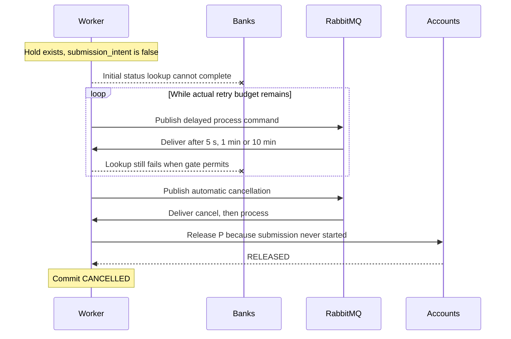

A hold alone does not authorize sending money. The worker must first persist submission intent and receive a new command with the updated version. Here every permitted lookup fails before that commitment. Payments can prove its code never sent the order.

The first bank failure schedules a five-second delay, the next a one-minute delay and the next a ten-minute delay. A further failed bank call exhausts the budget and schedules a command on `payments.cancel`. When consumed, it starts cancellation. The worker reaches `CANCEL_RELEASE_PENDING` and asks Accounts to release the hold, even if Banks is still unreachable.

**What Ana sees.** BRL 7,000 is available while the hold exists. With a confirmed release the payment is cancelled and BRL 10,000 is available again. The recorded run observed three retry publications, a cancellation command, one release and zero settlements.

**Try it locally.** Run `docker compose stop bank-simulator` before paying. Leave it stopped until the cancellation finishes, then run `docker compose start bank-simulator`. The walkthrough provides shorter demo delays.

[Automatic cancellation evidence](../evidence/explorations/03-automatic-cancellation.json) · [Stopped-provider test results](../evidence/resilience/checks.json)

<!-- page -->

## Banks times out after settling the bill

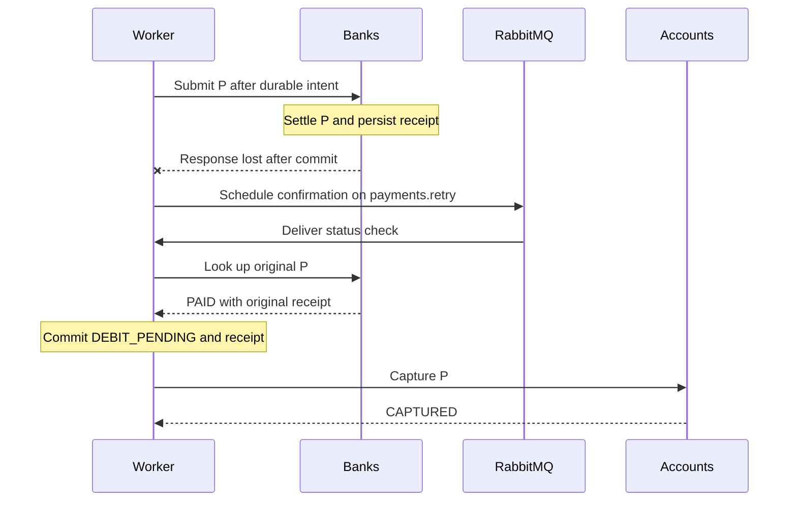

Banks can be healthy enough to execute a transfer while its reply never reaches the caller. The configured bank request timeout defaults to 2.5 seconds. A dropped response produces the same **unknown outcome** as a timeout. The worker stays in `AWAITING_CONFIRMATION`, preserves the hold and asks for the original reference when the retry is due.

**How a lookup changes the decision.** `PAID` with a receipt authorizes capture. `PROCESSING` schedules another status check, normally after five seconds. An absent reference on the submission path permits an idempotent submit under the existing ID. A malformed reply or a paid reply without a receipt leaves the result uncertain.

**Recorded proof.** In the lost-response exploration, Banks returned receipt `B-7a62c1f8-0ea6-4abe-ac58-9c67cb426a7f` on lookup. The bank recorded one paid event. Accounts recorded one reserve, one capture and zero releases. Ana had BRL 7,000 available both before and after capture.

**Try it locally.** Run `node demo/scripts/operator.ts bank mode lose-response` before paying. After verifying the receipt and ledger, restore the simulator with `node demo/scripts/operator.ts bank mode normal`.

[Lost-response observations](../evidence/explorations/01-provider-response-lost.json) · [Browser recording](../evidence/explorations/01-provider-response-lost.mp4)

<!-- page -->

## Cancellation while the bank outcome is unknown

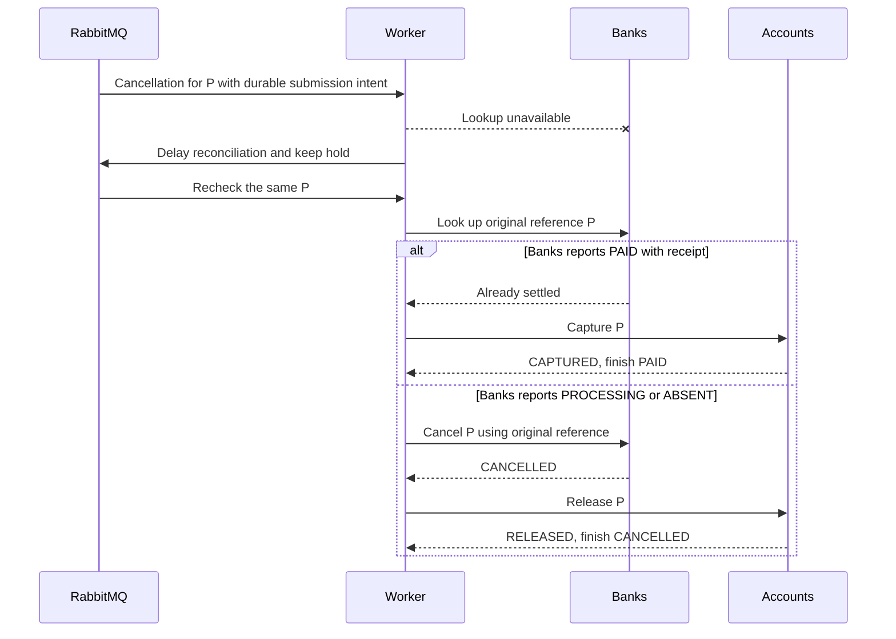

A customer request or an exhausted submission retry budget can enter `CANCELLATION_PENDING`. A versioned automatic cancel cannot override a newer decision. The worker serializes competing commands. A stale process instruction is ignored. A committed intent means a prior submission may already be on its way, even if the caller has yet to see a receipt.

Once the bank is reachable, the worker queries **P**. The cancellation contract must make an absent or processing reference definitively cancelled before funds are released. In the simulator, cancellation also records an absent reference as cancelled, so a delayed submit with P cannot pay it later. If the bank instead returns `REJECTED`, the release path ends in `FAILED`. If it returns `PROCESSING` again, the Saga keeps checking. A bank-confirmed payment always leads to capture.

**If Banks is silent for hours.** The hold remains. After the cancellation retry budget is spent, uncertain calls continue through deferred reconciliation, with a default interval of at least ten minutes. The same durable retry queue carries these checks. A worker is free to serve other payments between deliveries.

[Cancellation exploration](../evidence/explorations/02-manual-cancellation.json) · [Late-paid cancellation tests](../../payments/worker/tests/unit/advancePayment.test.ts)

<!-- page -->

## How the circuit breaker protects Banks

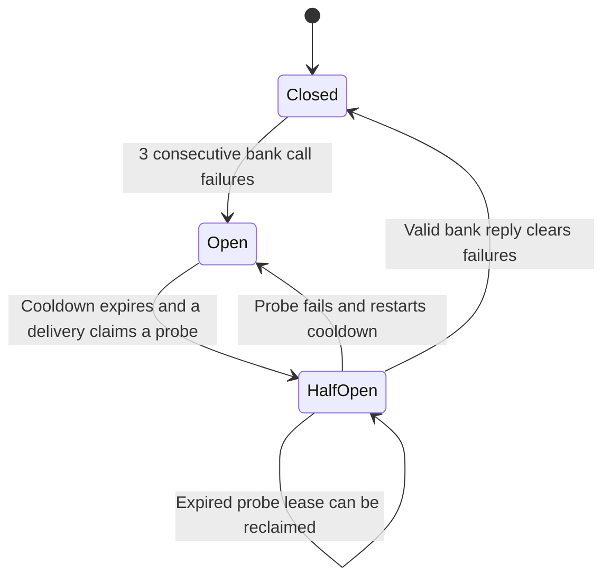

**Closed.** Worker replicas consult one `bank_breaker` row in Payments PostgreSQL before bank status, submit and cancel calls. Valid replies reset the failure count. A valid rejection is a business outcome. Three consecutive failed bank calls across replicas open the gate for 30 seconds by default.

**Open.** Before the deadline, the worker skips the HTTP call, records `BANK_CIRCUIT_OPEN` and publishes to `payments.retry` for the gate's next eligible time. That deferral preserves the payment's attempt count. The broker owns the wait. A worker restart leaves both the due delivery and the shared deadline recoverable.

**Half-open.** The next eligible delivery acquires a probe lease under a row lock. One worker calls the bank. Other workers defer. A valid response closes the circuit. A failed probe opens it again. If the probing worker dies, the lease expires. A generation and probe token prevent a stale result from overwriting a newer decision.

**A single payment with a continuously offline bank.** Its first three failed lookups schedule retries after 5 seconds, 1 minute and 10 minutes respectively. The third also opens the shared circuit. Other payments arriving during its cooldown wait for the probe. If the original payment's fourth permitted lookup fails, it queues automatic cancellation. Concurrent calls can change the timing of the probe.

The breaker controls **whether a provider call is allowed now**. A particular payment's retry budget controls **when the Saga requests cancellation**. The bank's definitive answer controls **whether the held money can be released**. The circuit's state and `payments.state` are independent.

**Watch the gate.** Run `node demo/scripts/operator.ts breaker --watch` during an outage. Compare its deadline and probe with the payment history.

[Shared breaker implementation](../../payments/worker/src/db/repositories/bankCircuit.ts) · [Probe recovery integration test](../../payments/worker/tests/integration/paymentRecovery.test.ts)

<!-- page -->

## Business failures and infrastructure boundaries

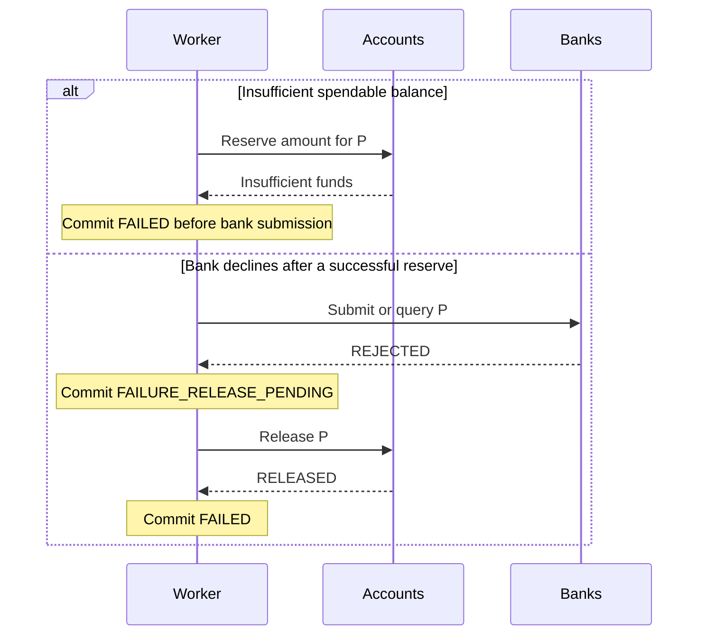

| Condition | Observable result and recovery |
|---|---|
| Concurrent spending | Accounts serializes ledger changes. Of four competing BRL 3,000 bills against BRL 5,750 in the recorded test, one paid and three failed for insufficient funds. |
| Reused idempotency key | Identical terms yield the same payment ID. Different terms against an existing row produce `409`. A racing conflict reaching the worker is audited without changing the original payment. |
| Payments PostgreSQL unavailable | API reads that need the database fail. A worker that cannot commit leaves the delivery unacknowledged. After reconnect it replays or reconciles the same command. |
| Malformed command | The worker publishes an invalid-command report to `payments.dlq` and waits for confirmation before ACKing the source. An operator investigates. |
| Telemetry unavailable | Trace or log evidence may be missing. The durable payment state, command receipts and owner ledgers still define the financial outcome. |

**Scope.** The local single-company fixture opens directly on loopback. Production work would include authenticated actors, access-controlled audit retention, a replicated broker and databases, and measured throughput and recovery objectives. The demo exercises independent worker deployment, concurrent spending and failure recovery. A Black Friday capacity figure would require a load test.

<!-- page -->

## Audit · reconstructing one payment

Payments records business decisions inside the same local transaction as their effects on workflow state. The bank receipt, account ledger and command receipt answer different questions. A trace explains how those records came to exist.

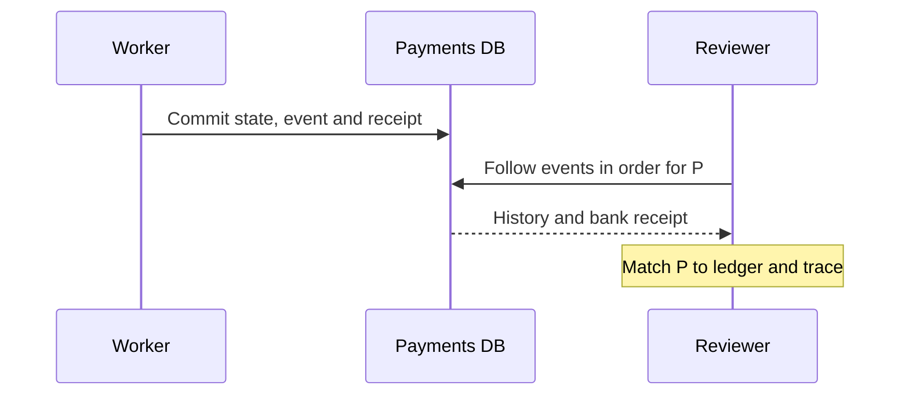

| Record | Question it answers |
|---|---|
| `payments` | What is the current state and version? What amount, bill, company, idempotency key, submission intent and provider reference belong to it? |
| `payment_events` | What decision was committed, in what order, by which component, at what time, in which state and version? The detail field can hold a reason. |
| `command_receipts` | Which input command was decided and what successor, queue and scheduled time must be replayed? A command can also have no successor. |
| Accounts and Banks | Did the owner record a hold, debit or release? Did the bank settle the reference and issue a receipt? Each owner supplies its own evidence. |
| OpenTelemetry | Which API call, message delivery and provider call belonged together? Tempo follows the trace, Loki correlates logs by trace ID, and Prometheus counts operations across payments. |

**An actual investigation.** The included recordings follow payment `663025f9-d64e-85af-a4d7-9eb6c84fc657`. Start with its ordered history. The retry precedes the bank confirmation, which precedes capture. Match its receipt against Banks and its one capture against Accounts. For the same run, the Grafana recording follows trace `c44464482054b4ef906234e81d180b5a`.

The API returns event types, component actors and timestamps. Ana sees plain-language event labels and times in the web app. Operators can inspect additional state and version details. Component actor names identify the API or worker in this demo. Retained traces are diagnostic evidence and may expire. The event table records committed decisions, so an API request that never reached the system has no payment event to show.

[Database schema](../../payments/infra/payments.sql) · [Recorded trace and correlated logs](../evidence/README.md) · [Telemetry assertions](../scripts/telemetry.ts)

<!-- page -->

## Running and checking the submission

From the repository root, start the three releases and observability stack with Docker Compose. The project README lists prerequisites and the commands for an existing deployment.

```sh
source demo/env.sh
docker compose build
docker compose up -d --no-build --wait
docker compose ps
```

Open **http://localhost:5173** for Ana's workspace and **http://localhost:3000** for Grafana. Pick Atlas Supplies on a fresh account. Copy the payment ID from the application. The following read-only commands show the committed workflow, the account effects, the bank receipt and the broker destinations.

```sh
ID='<payment ID copied from the app>'
node demo/scripts/operator.ts payment inspect "$ID"
node demo/scripts/operator.ts bank inspect "$ID"
node demo/scripts/operator.ts payment routes "$ID"
node demo/scripts/operator.ts breaker
```

In Grafana Explore, select Tempo and use `{ span.payment.id = "YOUR_PAYMENT_ID" }`. Open a matching trace and follow `payment.accept`, the RabbitMQ publish and consume spans, `accounts.reserve`, `bank.submit` and `accounts.capture` or `accounts.release`. The submission includes offline recordings for reviewers without a running stack.

| Where to look in the checkout | What to verify |
|---|---|
| `payments/worker/src/services/advancePayment.ts` | Forward steps, compensation and retry decisions. |
| `payments/worker/src/db/repositories/paymentCommands.ts` | Atomic local handoff, command receipts, versioning and replay. |
| `demo/docs/walkthrough.md` and `demo/docs/testing.md` | Operator controls, failure demonstrations and isolated test commands. |
| `demo/evidence/resilience/checks.json` | Worker termination, concurrent replay, missing confirms and broker restart. |
| `demo/evidence/explorations/` and `demo/evidence/telemetry/` | Browser observations, provider effects and the corresponding Grafana recordings. |

[Project README](../../README.md) · [Walkthrough](walkthrough.md) · [Test guide](testing.md) · [Evidence index](../evidence/README.md)
