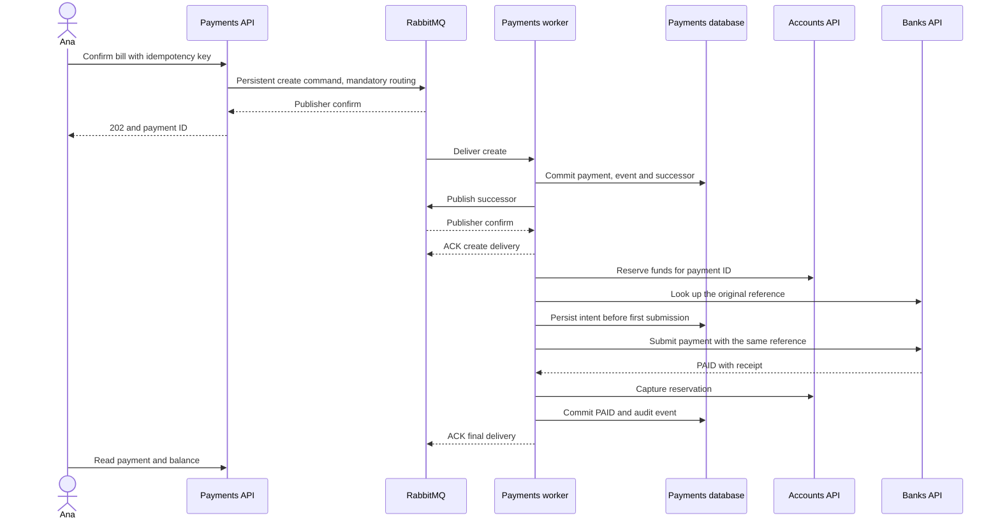

# Payment workflow, cancellation and recovery

Payments owns the orchestration. Provider contracts must give Payments a stable identity per instruction, an idempotent transfer and a way to query a definitive outcome. Accounts must make reserve, capture and release idempotent. A real provider lacking these guarantees needs a different reconciliation agreement before automated release is safe.

## Successful payment

Each step uses a separate delivery. One database transaction records the new state, incremented version, audit event and command result. After commit the consumer publishes any successor, waits for the broker's confirmation and then acknowledges the delivery. On redelivery it can reuse the recorded decision and successor. This is at-least-once delivery with idempotent financial operations. Crash recovery needs no outbox publisher.

## Queues and state

| Queue | Purpose |
|---|---|
| `payments.create` | Accept a new instruction and establish its initial state |
| `payments.process` | Execute the next business step |
| `payments.retry` | Hold both retries and reconciliation commands until their scheduled delivery time |
| `payments.cancel` | Accept user-initiated or automatic cancellation |
| `payments.dlq` | Park a command that requires operator review |

The workflow has a single `state` column. A successful payment usually goes from `RESERVATION_PENDING` through `AWAITING_SUBMISSION`, `AWAITING_CONFIRMATION`, `DEBIT_PENDING` and `PAID`. It can reach `FAILED` on insufficient funds or after a definitive rejection and release. Cancellation uses `CANCELLATION_PENDING`, may require `CANCEL_RELEASE_PENDING`, and ends at `CANCELLED` once the reservation is released. See the [state machine](../worker/src/services/advancePayment.ts) for every transition.

## When the bank is unavailable

The default retry delays are five seconds, one minute and ten minutes. The quorum retry queue schedules delivery, so an idle worker can restart during the wait. A separate circuit breaker protects the bank across all worker replicas. Its failure count, probe and open-until time live in Payments PostgreSQL. A delivery encountering an open breaker waits for a probe without counting that wait as another bank attempt.

When retries are exhausted, the worker publishes a cancellation. If no submission could have occurred, the worker releases the reservation. Once the original instruction might have reached Banks, it keeps funds reserved and schedules a lookup. A late `PAID` requires capture even after a cancellation request. A definitive cancellation permits release. Account failures that exhaust their retry budget are flagged for review.

| Failure window | Recovery |
|---|---|
| API loses publisher confirmation | Return 503. The client retries with the same key. |
| Worker dies after commit and before publishing or acknowledging | The unacknowledged delivery returns to the queue. The stored command receipt gives the new worker its successor. |
| Banks settles but loses the response | The worker looks up the original reference. The same settlement receipt leads to a single capture. |
| RabbitMQ restarts after confirming a command | The durable queue and persistent message survive a restart with the same volume. |
| Cancellation races a submission | Payments serializes decisions for the payment and records durable submission intent before a remote submission. |
| Operator intervenes after an extended failure | Inspect the timeline, provider result, account ledger and breaker. Redrive the reviewed command using its existing ID. |

## Audit and operations

`payments` records the current state and version. `payment_events` records ordered transitions, origin, reason and time. `command_receipts` records processed commands and their successors. `bank_breaker` holds the shared circuit state. All of these belong to Payments. Its API role reads the payment and history tables. The worker role writes the workflow. The audit identifies the API and worker as command sources. The local demo has one company and no end-user sign-in.

Inside a worker container run `node backend/scripts/operator.ts inspect UUID`, `routes UUID` or `breaker`. To redrive a reviewed payment, run `node worker/src/index.ts redrive UUID`. The lab walkthrough includes separate owner CLI commands for inspecting settlement and the account ledger.
